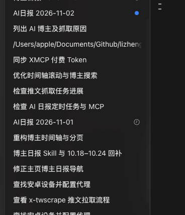
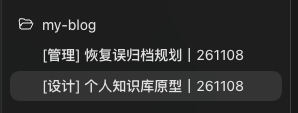

## 会话一多，就要反复点进去辨认

工具用多了，会话也越开越多。回头翻列表，有的是默认标题，有的只剩半句话，还有的显示项目路径。想找之前做过的事，只能逐个点开，看一遍上下文。



给新会话加上分类、事项和日期，扫一眼列表就更容易认出来。



比如 `[设计] 个人知识库原型｜261108`，分类和事项都写在标题里，`261108` 是北京时间的发起日期。

## 配置到全局 AGENTS.md

以 Codex 为例，全局指令文件默认为 `~/.codex/AGENTS.md`。如果设置了 `CODEX_HOME`，则使用对应目录中的 `AGENTS.md`。新启动的会话会读取这些指令，具体顺序见 [OpenAI 的 AGENTS.md 文档](https://learn.chatgpt.com/docs/agent-configuration/agents-md)。

可以自己编辑文件，也可以把下面这段话交给 Codex 检查并配置。

```text
请检查 Codex 的全局 AGENTS.md，保留其中已有的所有内容。
如果已经有下面这条规则，就不要重复添加；否则追加进去。
完成后告诉我配置文件路径，并验证新会话能读取到这条规则。

仅在新主会话首次明确任务时，用改名工具设标题为「[分类] 简短事项｜YYMMDD」，日期取北京时间的发起日期。只命名一次，尊重用户指定标题；不检查完成状态、不自动增删状态标签。改名不可用时继续任务。
```

自己配置的话，把最后一段规则追加到全局 `AGENTS.md`，保留文件里已有的内容。再新开一个会话，给出明确任务，看看标题是否符合约定。

## 命名规则的边界

标题能帮你找回会话，想起当时在做什么。任务是否完成，仍要看会话内容。规则只在新主会话首次明确任务时命名，不会检查完成状态，也不会自动增删「已完成」之类的标签。

`AGENTS.md` 是给 Agent 的指令。能不能改名，还取决于当前客户端是否提供改名工具。其他 Code Agent 的全局指令文件和工具可能不同，需要按实际情况调整。

Codex 优先读取全局目录里的 `AGENTS.override.md`。如果这个文件非空，就不会读取同目录的 `AGENTS.md`。项目里的更具体指令也可能影响行为。
