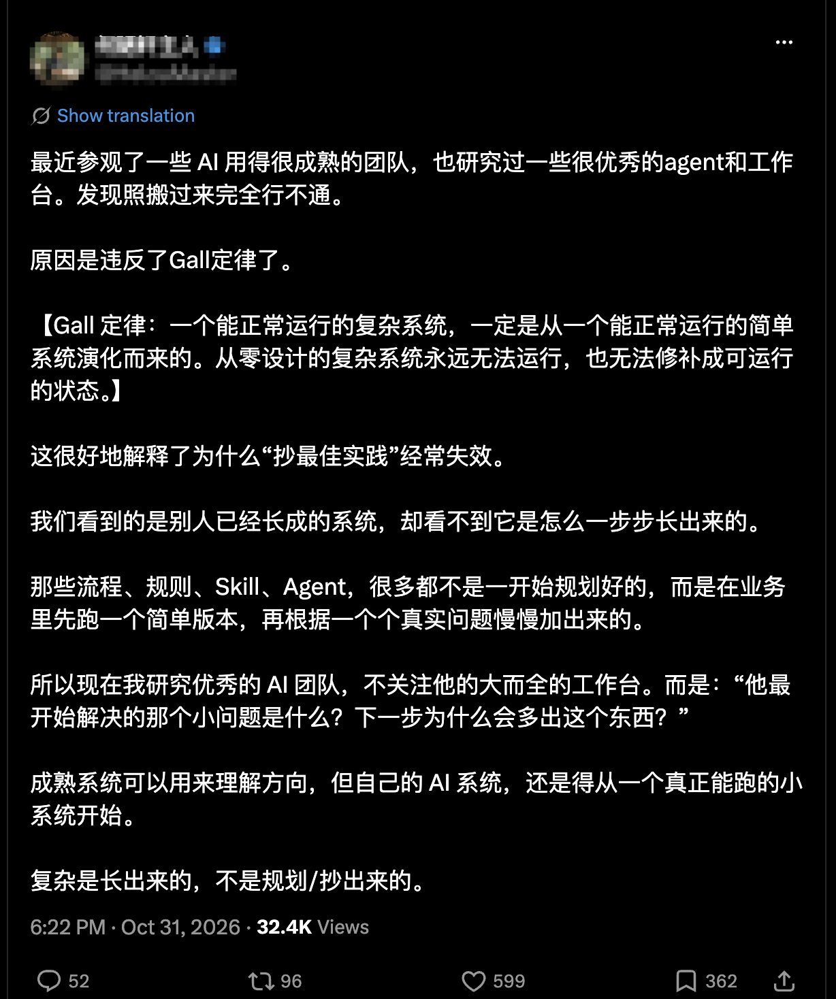

> 中文版：[读着有道理，已经说明不了什么](/posts/20261102-ai-slop-attention/)

There's more and more AI slop on X, meaning AI content that goes out without anyone reviewing it, and I've been trying to work out how to filter it. A few days ago I read a post that showed me my filter had a problem: if something read smoothly, I believed it.

The post was about AI teams. Its author had visited some teams that use AI very well, and said copying best practices often fails because it violates Gall's Law: complex systems that work grow out of simple systems that work.

My first reaction was that the argument made sense, and its citation was basically accurate. Then I had AI check the argument and found it only partly right. For example, Spear and Bowen, who studied Toyota, offered another explanation: outsiders copied the tools but not the rules behind them. So the failures may not come only from too much complexity. Both explanations could be true at once.

The post wasn't slop, and it raised a good question. What bothered me was my own reaction. Something reads smoothly, it's well structured, its view looks correct, and I nod along. AI can now write all of that in seconds. Sounding right proves nothing anymore.

So how should I filter, so that I read less of this and keep my attention for the work in front of me? I had three tests, and each one turned out to need changing.

The first was to be wary of content that just hands you the basics. AI already knows most of them, and much of the useful-looking material on X is people repeating each other. That's broadly true, but repeating isn't the problem. A good repost has done some filtering for me. Good and bad reposts look alike, so how do I tell them apart? I check whether the person added their own verification, a counterexample, or a trade-off.

The second was to look at range. If an account posted about huge news today, a breakthrough from ten years ago tomorrow, and AI coding the day after, I'd block it. I assumed people who touch everything probably have no real depth. This was my favorite test, and the most wrong. An account that only posts about AI coding may also be nothing but repetition. And the psychologist Philip Tetlock tracked expert forecasts for nearly twenty years and found that people who drew on many ideas and changed their minds did better than those who clung to one big theory. That finding is about ways of thinking, not what people post about, so it's only a weak analogy. It was still enough to stop me judging truth by breadth.

The third was to look for real-world feedback: has this person's judgment been tested by actual results? I still believe in this one, but it has three traps.

The first trap is that feedback isn't always valid. Kahneman and Klein argue that intuition earns trust only when the environment has regularities and the feedback is timely and accurate. A firefighter's intuition holds up. A stock broker's may not.

The second trap is that even valid feedback lights up only a small area. After Intel's recent plunge, everyone had an explanation. That's outside my feedback range, so I can't judge who's right. My impression is just that most people see only the tip of the iceberg, including those who really know the field. Take me. I've written backend code for over ten years, the services behind websites and apps, so I'm an old engineer and, half joking, about to be replaced by AI. Still, I've actually done distributed systems design, cloud, infrastructure, and networking, and I've worked on community and gaming products. Reality has tested that experience, which makes it harder for AI to replace right away. It stops there, though. On something like Intel, my judgment may not be reliable. So respect someone's depth, but trust them only inside their feedback range.

The third trap is that "mistakes I've made" can now be generated too. AI can write specific failures, numbers, and costs. A personal account alone isn't evidence. It has to match something public.

Back to that post. Copying best practices often fails: that may be true, and the author may have seen it firsthand. The trouble is the second half, "because it violates Gall's Law." Reality can prove that something happened. Proving why is much harder. If the author never compared those failures with teams that copied the same practices and succeeded, there's no way to say Gall's Law was the cause.

So when I read something, I plan to spend 15 seconds on three questions, to decide how far to trust it and whether to keep reading:

1. Does it touch a problem I'm working on? If not, scroll on.
2. Can I check it? Is there public code, a product, or data, and not just the author's description?
3. Is it saying what happened, or why? If why, did the author rule out other explanations?

Take Mitchell Hashimoto's AGENTS.md, a project file with instructions for AI. Hashimoto, a well-known programmer, says every line records a mistake the AI once made. The file is public, so I can read the rules one by one. Only "every line records a mistake" remains self-report. That's far easier to check than the usual experience post.

The post at the start didn't say what it had compared, so I count it as failing question three. But it touched something I was thinking about. So I drop its explanation and keep its question.

Question one saves the most time. Even a true post isn't worth reading now if it has nothing to do with the work in hand. Lizheng, a Chinese AI commentator, has said that algorithmic platforms reward spectacle: they tell you a lot while you understand little, and that gap is information anxiety. Lizheng runs courses and a community, so this view isn't disinterested, but I agree with the remedy. Stop trying to keep up with everything, and dig all the way into the problem in front of you. Then much of what's new can go unread.

The three questions work on single posts. To read less, I also have to control what gets in, so I want three rules.

- Follow no one by default, with a cap of 30. Before following someone, I want to see 3 posts I can check that keep what happened apart from why, and then a continuous track record of over three months. Long-running projects, updates, and public changes of mind are harder to fake, though not impossible.
- Mute ordinary slop. Block only repeat exaggeration and fabrication. I used to say block on sight. Now I think the habit to build is not following in the first place.
- Let trending topics sit for 7 days, and check only once or twice a day at fixed times. Assuming an average of 1 post per person per day and 15 seconds per post, 30 people take seven or eight minutes a day to screen, not counting close reading. If people who've actually done the thing are still discussing specifics after 7 days, it won't be too late to look.

How do I pick the 30? I've already done one round. The data came from two places: ChatGPT Pro web research, and several good WeChat groups connected through MCP, an interface that lets AI read outside data. The groups gave me chat history going back to 2024, and an AI agent analyzed the recommendations people made there, along with what it found by searching. Then came two steps: a rough cut to 50 to 100 people, then checking them one by one, leaving 20 to 30. The list isn't fixed, but it's a good enough start: wide coverage, little overlap. The list and the exact method are at the end.

I've picked people, but I haven't yet run the three questions and three rules together, so this is an experiment. For two weeks I'll read as usual and log my weekly reading time and how often something made me actually change something, like code, a document, or a decision. Then I'll follow the rules for 30 days and read one AI newsletter a week, written by someone else, to see what I missed. The experiment passes if reading time falls by at least 30%, things that change my work don't get less frequent, and I don't miss anything important.

This only tests whether I read less, not whether I believe fewer wrong things. Wrong beliefs often take a long time to surface, and 30 days won't show them. I'll just record how many things I nodded at and later found wrong, and how anxious I feel.

The feedback test applies to me too. Reposting an article, chasing a trend, or writing a viral post earns only likes. Reality hasn't touched any of it. Even with AI, getting something done takes patient work, and I'm saving attention so I can do work that can be tested. These rules won't stop people who package themselves carefully, and I haven't figured out what to do about that. I haven't tried running my own writing through the three questions either.

## My list

These are the 24 accounts I read now. That's under the cap of 30, and it will change. A few mainly explain things in Chinese or surface tools, like Baoyu and Guizang. That's the good kind of repeating.

Don't copy it as is. The post at the start got one thing right: what you copy lacks the process that grew it. Use this list as a starting point for a rough cut, and decide who stays based on the problems you're working on.

| Account | Focus | Why I read them |
|---|---|---|
| Andrej Karpathy · [@karpathy](https://x.com/karpathy) | Model fundamentals, teaching | Explains model internals, training intuition, and engineering observations clearly, with courses and code to follow. |
| Simon Willison · [@simonw](https://x.com/simonw) | Applied engineering, security | Keeps a running record of tool tests, failure boundaries, and prompt injection, which helps me judge whether an AI tool can be relied on. |
| Sebastian Raschka · [@rasbt](https://x.com/rasbt) | LLM training, teaching | Implements LLMs from scratch, covering inference, evaluation, and post-training. Good for systematic study. |
| Boris Cherny · [@bcherny](https://x.com/bcherny) | AI coding, engineering process | For how Claude Code is used in real engineering: verification and collaboration methods. |
| Lilian Weng · [@lilianweng](https://x.com/lilianweng) | Technical surveys, agent architecture | Organizes the literature on agents, reinforcement learning, and reasoning into a system, which helps me follow how the field developed. |
| Hamel Husain · [@hamelhusain](https://x.com/hamelhusain) | AI evals, product quality | Error analysis, eval systems, model judges, and feedback loops, for turning a demo into a reliable product. |
| Nathan Lambert · [@natolambert](https://x.com/natolambert) | Post-training, open models | Follows RLHF, reward models, and post-training, which shows how model capabilities form. |
| Mitchell Hashimoto · [@mitchellh](https://x.com/mitchellh) | How engineers use AI | Shows how a senior engineer fits agents into daily development. |
| Jim Fan · [@drjimfan](https://x.com/drjimfan) | Embodied AI, robotics | Robotics, world models, and foundational agent research add a view beyond pure software. |
| Dylan Patel · [@dylan522p](https://x.com/dylan522p) | Compute, industry economics | GPUs, memory, networking, power, and training and inference costs: the industry's constraints. |
| Dwarkesh Patel · [@dwarkesh_sp](https://x.com/dwarkesh_sp) | Deep interviews with researchers | Long interviews and follow-up questions on research directions, compute demand, and disagreements. |
| Awni Hannun · [@awnihannun](https://x.com/awnihannun) | Local inference, ML systems | Inference and MLX work, connecting algorithms to local computing. |
| Noam Brown · [@polynoamial](https://x.com/polynoamial) | Reasoning models, search | Game theory, search, and reasoning models show how more computation raises capability. |
| Jack Clark · [@jackclarksf](https://x.com/jackclarksf) | Research news, AI governance | Import AI links new research to policy and social impact. |
| Justin Lin · [@justinlin610](https://x.com/justinlin610) | Open models, multimodal | Public research and model reports on LLM and multimodal training. |
| Thariq Shihipar · [@trq212](https://x.com/trq212) | Agent products, context engineering | The specific design thinking and technical methods behind AI coding tools. |
| Baoyu / Jim Liu · [@dotey](https://x.com/dotey) | Chinese-language explanation, AI practice | A Chinese entry point to English sources, plus translation, explanation, and open-source tools. |
| Guizang · [@op7418](https://x.com/op7418) | AI products, creative workflows | Surfaces products, tools, and creative methods I can try right away. |
| Hokin Deng · [@denghokin](https://x.com/denghokin) | Vision, world models | A research author who surfaced in the group chats, with papers, data, and code to go deeper. |
| Muratcan Koylan · [@koylanai](https://x.com/koylanai) | Context engineering, agents | Public context-engineering skills and agent methods, good for hands-on learning. |
| Ben Tossell · [@bentossell](https://x.com/bentossell) | Non-engineers building AI products | Personal build logs and tutorials, covering both tool discovery and product experiments. |
| Zhixian · [@zhixianio](https://x.com/zhixianio) | Chinese AI engineering, indie development | Recognition in the groups, plus public technical work. |
| yetone · [@yetone](https://x.com/yetone) | Open-source AI apps, engineering | Public projects whose code I can read to see how a product is built and iterated. |
| Niels Rogge · [@nielsrogge](https://x.com/nielsrogge) | Model implementation, tutorials | Transformers tutorials, model integrations, and runnable examples that turn research into code. |

## Appendix: how this list was actually made

The numbers below come from my local records. Where I have a real number, I give it. Where something wasn't kept, I say so.

The data had two sources. One was ChatGPT Pro web research. Those conversations aren't saved locally, so I can't show the prompts or raw results. The other was 5 WeChat groups, all connected through MCP and analyzed by an AI agent. The groups are private discussions, so I'm not naming them. I still have local exports of two: one with 175,000 messages from March 2024 to October 2026, and one with 29,000 messages from November 2025 to September 2026. I didn't count the size of the other three for this post.

| Step | What happened | Result |
|---|---|---|
| Rough cut | Merged leads from the web research and the groups | 50 to 100 people. This number is from memory; the intermediate list wasn't kept |
| One-by-one check | Recorded each person's focus, why to read them, a link to their work, which groups the leads came from, an evidence level, and a rank | All 24 have a work link |
| Final list | Ranked them and kept a shortlist, with focus areas overlapping as little as possible | 24 people, from model fundamentals and AI coding to compute and governance |
| Tracking | Connected all of them to an x-ai MCP that collects their posts for a daily digest | First daily digest of these accounts ran on October 28, 2026 |

Of the 24, the evidence levels split evenly: 12 are labeled "priority in both rounds" and 12 "extended: strong public work." Group mentions split evenly too: 12 came up in two or more groups, 12 in only one. Hokin Deng, for example, came up in one group and stayed because there are papers, data, and code to follow. Mitchell Hashimoto also came up in one group, but has public long-form writing.

Everyone who stayed has one thing in common: their work can be pointed to in public. The method has three weak spots. My records don't say what the two rounds were or how "priority" was decided. I entered these fields myself when importing them, and the system didn't verify them independently. And these 24 were picked before the three questions and three rules existed, so they haven't been re-screened under them.

## How this post was made

I dictated this post and had it transcribed. It went through many rounds of reflection: my own thinking and brainstorming, and many conversations with AI, far more than the discussion while organizing it. On that basis I used AI (Claude Opus 5.5) to organize the final version, and the same model adapted this English version from the Chinese post.

## Notes

- I didn't name the post at the start. It isn't bad; I only use it to talk about my own reaction.
- On the word slop: [Simon Willison, Slop is the new name for unwanted AI-generated content](https://simonwillison.net/2024/may/8/slop)
- Toyota: Spear & Bowen, Decoding the DNA of the Toyota Production System (1999). I read a [summary](https://maaw.info/ArticleSummaries/ArtSumSpearBowen99.htm).
- Expert forecasting: Tetlock's Expert Political Judgment. I read a [secondary review](https://scholars-stage.org/foxes-hedgehogs-and-forecasting/). "Foxes" and "hedgehogs" classify ways of thinking. The research is about forecasting, not social media accounts.
- Conditions for intuition: [Kahneman & Klein 2009 abstract](https://pubmed.ncbi.nlm.nih.gov/19739881/). The firefighter and broker contrast is in [this commentary](https://www.thedecisionlab.com/insights/society/thinking-fast-when-intuition-isnt-all-bad-according-to-its-biggest-critic).
- AGENTS.md: [Mitchell Hashimoto, My AI Adoption Journey](https://mitchellh.com/writing/my-ai-adoption-journey)
- Lizheng's remarks, in Chinese: [AI 已经用得很好，为什么还是怕被淘汰？](https://www.youtube.com/watch?v=k11SG-gJzzY&t=819s)
- The Intel line is only my impression, not a research finding.
- Experiment details: all comparisons use weekly averages. I'll also read the newsletter in the first two weeks, and that time counts as reading time. I'll judge the result 7 days after the 30 days end, because trending topics sit for 7 days. A miss counts only at 2 or more important items in total. An item is important if I changed my work within a week of learning about it. "Less frequent" means below 70% of the first two weeks. Changes triggered by the newsletter are logged separately and excluded from this count. If reading time doesn't fall, halve the follow cap. If it falls but I miss too much or change less, the filter is too strict, so lower the follow bar from 3 posts to 2.
- The list is the early November 2026 version. The focus areas and reasons are my selection notes from that time.
- 15 seconds, 30 people, 7 days, 30 days, and 30% are starting points I chose, not research findings.
