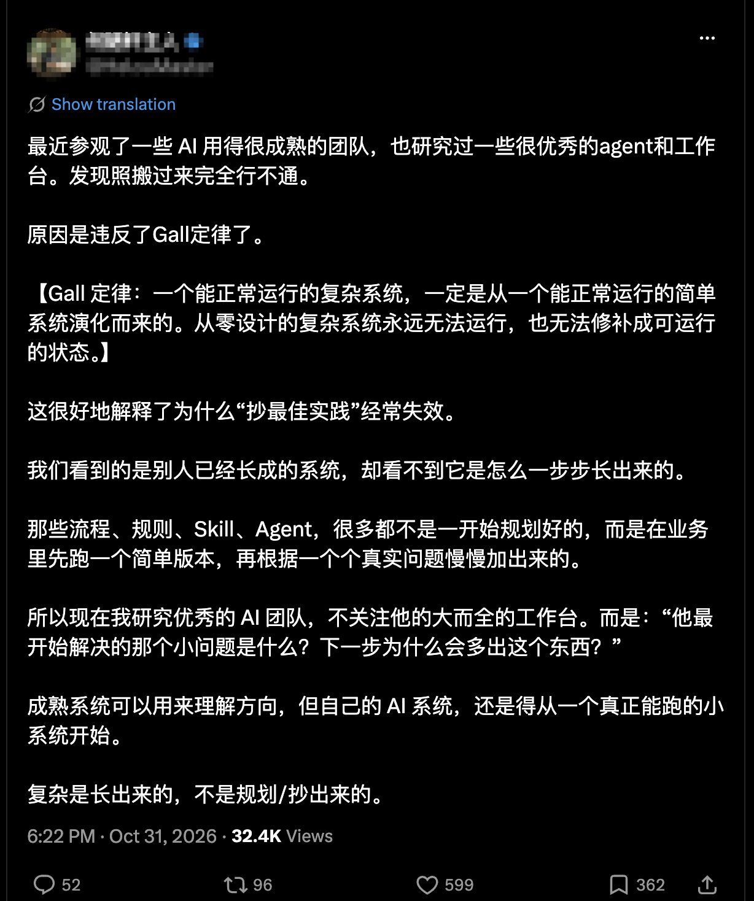

推特上的 AI slop（没人审过就往外发的 AI 内容）越来越多，我一直在想怎么筛。前几天读到一段话，让我发现自己的筛子有问题：读着顺，我就信了。

那段话讲 AI 团队。作者参观了一些 AI 用得很成熟的团队，说抄最佳实践经常失效，原因是违反了 Gall 定律：能运行的复杂系统，都是从能运行的简单系统长出来的。

我的第一反应是挺有道理，引文也基本没错。可我让 AI 查了一轮，发现它只说中了一部分。比如研究丰田的 Spear 和 Bowen 给过另一种解释：外人抄走了工具，没抄走背后的规则。这样一来，失败的原因也未必只是系统太复杂，两种解释可能同时成立。

这段话算不上 slop，它还提了个好问题。让我在意的是我自己的反应：一段话顺、结构清楚、观点正确，我就点头了。这些东西 AI 现在几秒钟就能写出来。读着有道理，已经说明不了什么。

那么该怎么筛，才能少看点这类东西，把精力留给手上的事？我原来有三条判断，后来发现每条都得改。

第一条是警惕喂饭。大部分基础知识 AI 自己就会，推特上很多干货只是大家在互相转述。这条大体对，但转述本身没有错，好的转述替我做了一次筛选。表面都是转发，怎么区分？看他有没有加上自己的验证、反例或取舍。

第二条是看涉猎。一个账号今天发惊天大事，明天发十年前的突破，后天又讲用 AI 写代码，我原来会直接 block（拉黑），觉得什么都沾一点的人，多半没有真实积累。这条我最喜欢，也错得最多。一个账号天天只发 AI 写代码，也可能全是转述。反过来，心理学家 Tetlock 跟踪专家预测近二十年，发现思路杂、肯改主意的人，比抱着一个大理论的人更准。他说的是思维方式，不是发帖题材，这只算弱类比，但至少让我不敢再用宽窄判断真假。

第三条是看现实反馈，也就是他的判断有没有被真实结果检验过。这条我现在还信，但有三个坑。

第一个坑是，反馈不一定有效。Kahneman 和 Klein 认为，直觉要可信，环境得有规律，反馈也要及时准确。比如消防员的直觉靠得住，选股的经纪人就不一定。

第二个坑是，有效的反馈也只照亮一块地方。前段时间英特尔暴跌，大家都在讲原因。这超出了我的反馈范围，我判断不了谁对，只觉得多数人看到的都是冰山一角，包括真懂行的人。我也一样，写了差不多十年后端（网站和 App 背后的服务），做过云计算和基础设施，现在做社区治理。这些地方我有点判断力，换个领域就未必了。所以我们要尊重一个人的深耕，但只在他的反馈范围内相信他。

第三个坑是，「我踩过的坑」现在也能生成。具体的失败、数字和代价，AI 都写得出来。单凭自述不算证据，要能和公开的东西对上。

回头再看开头那段话。抄最佳实践经常失效，这个现象可能是真的，作者也许亲眼见过。出问题的是「因为违反了 Gall 定律」这半句。现实能证明一件事发生过，却很难证明它为什么发生。他要是没比较过同样抄了做法却成功的团队，就说不清失败是不是因为这个。

所以读一条内容时，我打算花 15 秒问三个问题，决定信到哪一步、要不要继续看：

1. 它碰我手上的问题吗？不碰就划走。
2. 我能核对吗？有没有公开的代码、产品或数据，而不只是他的描述？
3. 他说的是发生了什么，还是为什么？如果是为什么，他排除过别的解释吗？

比如知名程序员 Mitchell Hashimoto 讲他的 AGENTS.md（写给 AI 的项目说明），说每一行都对应一次 AI 犯过的错。文件是公开的，规则我能逐条看，只有「每行对应一次错」还是他的自述。这比一篇经验帖好核对得多。

开头那段话没写对比过什么，我就当它没过第三问。可它碰到了我在想的问题，所以我不信它的解释，留下它的问题。

第一问最省时间。一条内容就算是真的，只要和手上的事无关，现在也不值得看。中文 AI 博主课代表立正说过，算法平台奖励奇观感，告诉你很多，你却理解很少，这个落差就是信息焦虑。他做课和社区，说这话有立场，但他的办法我认同：别想着事事跟上，把手上的问题钻到底，很多新东西就可以不追。

三问管的是单条内容。要少看，还得管住入口，我想再定三条规矩。

- 默认不关注，上限 30 人。想关注一个人，先看到 3 条能核对、分得清发生和为什么的内容，再查到三个月以上的连续轨迹。长期的项目、更新和改口更难伪造，但不是不能。
- 普通 slop 用静音，反复夸大、编造的才 block。我原来主张见一个拉黑一个，现在觉得要养成的习惯是默认不关注。
- 热点放 7 天，每天只在固定时段看一两次。30 人按平均每人每天 1 条、每条 15 秒算，每天筛一遍只要七八分钟，细读另算。7 天后还有做过的人在讲具体用法，再看也不迟。

这套办法我还没跑过，所以先当实验。前两周照旧，记下每周看了多久，有几次看到的内容让我真的改了东西，比如改代码、改文档、做决定。接下来 30 天按规矩来，每周看一份别人整理的 AI 周报，查查漏了什么。到时阅读时间降了三成以上，让我真的改东西的次数没变少，也没漏重要内容，就算过关。

这个实验只验证看得少了，不验证信错得少了。信错往往很久才发现，30 天看不出来，点头后发现不对的条数和焦虑感我只记录。

看现实反馈这条也适用于我自己。转一篇文章、追一个热点、出一篇爆款，换来的只是点赞，都没有被现实打过。有 AI 帮忙，想做成事也得踏实积累，省下注意力就是为了去做能被检验的事。这几条挡不住精心包装的人，这点我还没想好怎么办。我自己写的东西能不能过这三问，我也还没试过。

## 后记：这篇文章是怎么来的

这篇文章是我先口述转成文字的。它经过了多轮反思，不只是整理这篇时的讨论，我自己也做过很多思考和头脑风暴，还和 AI 有过多轮对话，远不止整理时的这一段。在多次反思和自我观察的基础上，最后我用 AI（Claude Opus 5.5）整理出了现在的版本。

## 注

- 开头那段话我没有点名，它本身不差，这里只借它说我自己的反应。
- slop 的说法：[Simon Willison, Slop is the new name for unwanted AI-generated content](https://simonwillison.net/2024/may/8/slop)
- 丰田：Spear & Bowen, Decoding the DNA of the Toyota Production System（1999），我读的是[摘要](https://maaw.info/ArticleSummaries/ArtSumSpearBowen99.htm)
- 专家预测：Tetlock 的 Expert Political Judgment，我读的是[二手评述](https://scholars-stage.org/foxes-hedgehogs-and-forecasting/)。「狐狸」和「刺猬」是思维方式的分类，研究对象是预测，不涉及社交媒体账号。
- 直觉的条件：[Kahneman & Klein 2009 摘要](https://pubmed.ncbi.nlm.nih.gov/19739881/)，消防员和经纪人的对比见[这篇评论](https://www.thedecisionlab.com/insights/society/thinking-fast-when-intuition-isnt-all-bad-according-to-its-biggest-critic)
- AGENTS.md：[Mitchell Hashimoto, My AI Adoption Journey](https://mitchellh.com/writing/my-ai-adoption-journey)
- 立正的说法：[AI 已经用得很好，为什么还是怕被淘汰？](https://www.youtube.com/watch?v=k11SG-gJzzY&t=819s)
- 英特尔那句只是我的感觉，不是研究结论。
- 实验细则：都比每周平均数；前两周也看周报，周报时间算进阅读时间；30 天后再等 7 天判定，因为热点要放 7 天；累计漏 2 条以上才算漏，重要内容指知道后一周内因它改了工作；改动低于前两周的七成才算变少，周报引发的改动单列，不算在内；时间没降就把关注上限减半；时间降了，但漏得多或改动变少，说明筛得太狠，关注门槛从 3 条降到 2 条。
- 15 秒、30 人、7 天、30 天、三成这些数是我定的起点，不是研究结论。
