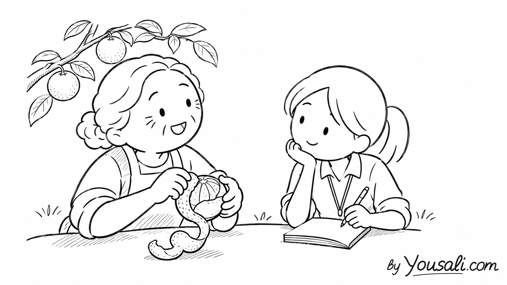

褚时健生于1928年，早年曾管理过玉溪卷烟厂和红塔集团，后来因经济问题入狱。2000年左右，他因严重糖尿病获批保外就医，出来以后，他和妻子马静芬面临不小的生活资金压力，没有现成的产业，手里也拿不出多少周转资金。2002年前后，两人开始在云南玉溪新平县的哀牢山种植冰糖橙。

开山种橙处处都要花钱，进山以后先得修路和引水，接着还得买树苗、请工人干活，每一笔开支都绕不开。夫妻俩手头没有多少本钱，起步时靠亲友一家三五万或十来万地帮衬，先凑齐了120万元。这笔钱先投入试种，后来随着园子扩至2000多亩，投入不断增加。在[2009年刊发的访问](https://finance.sina.cn/sa/2009-03-13/detail-ikkntiam3855467.d.html?vt=4)中，褚时健和马静芬回忆，园子扩大之后，他们前后累计大约借了2000万元。

钱陆续借来以后，更磨人的是果树生长的等待期。冰糖橙从栽下树苗到挂果的周期很长，前几年山里几乎只有持续不断的投入，见不到什么产出。夫妻分工很明确，按两人在访问里的自述，一人管种植、一人管销售，由他种、她来卖。在种植这一头，他主要研究土壤，提高果子的糖分。

这样在山里守了几年，果园终于迎来了转机。在那次访问现场，马静芬给记者剥了几个自家种的橙子，褚时健随后说起果园后来的品质、产量和还账。按他的说法，到了2006年，这片橙园已进入收获期，产量达到1700多吨，他们也是从这一年开始还钱。到了2008年，此前陆续借来的款项基本还清。

