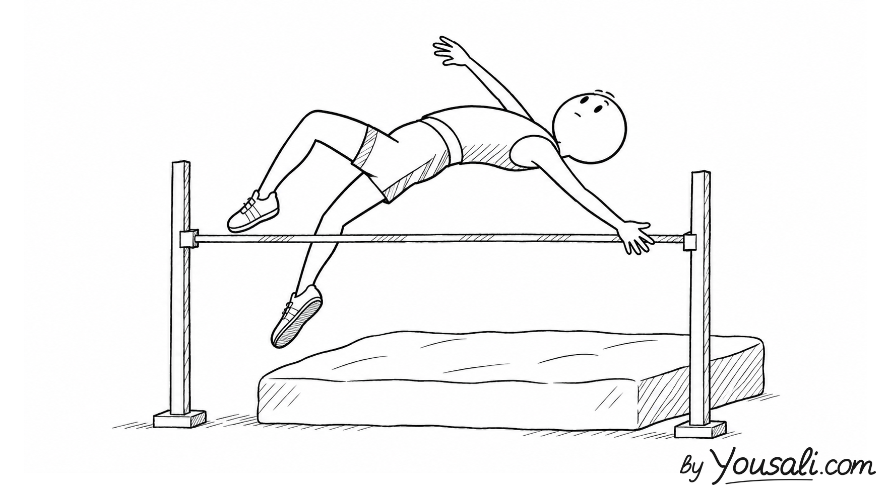

1963 年，还在读高中的迪克·福斯贝里练俯卧式跳高总觉得不适，在一次比赛中主动退回更基础的剪式重新找感觉。此前很长一段时间里，跳高赛场上通行的是跨栏一样的剪式，以及后来一直占主流的俯卧式，运动员面对横杆起跳，俯卧着贴近杆面翻过去。早期跳高落地区多是沙坑或木屑坑，人从半空掉进坑里，只能双脚先着地，或者用手脚撑住地面，免得摔伤。

在[福斯贝里本人的访谈](https://speedendurance.com/2007/06/15/dick-fosbury-former-olympic-high-jumper/)中，他回忆那次退回剪式后，动作并不是一下子定型的。随着比赛横杆一次次升高，他为了越过横杆才开始抬起臀部并把肩膀往后仰，那一场就把成绩提高了六英寸。但这套姿势当时还远未成熟，之后他又花了两年时间反复修正，才一步步发展成头先过杆、从背后越过横杆的动作。

在沙坑或木屑坑的时代，背朝下落地很容易伤到颈背。那段时间，泡沫海绵落地区正在赛场逐步推广，松软的垫子减少了落地受伤的风险，让背部着地变得更可尝试。不过新跳法并非只靠更换落地区就能成立，垫子只是提供了更安全的落地条件，从临场抬臀仰肩到稳定地头先过杆，靠的还是福斯贝里这两年的持续修正。

[国际奥委会的技术梳理](https://www.olympics.com/ioc/news/richard-fosbury-high-jump-revolution)将这种从背后过杆的方式视为继剪式与俯卧式之后的技术变革。据[国际奥委会回顾记录](https://www.olympics.com/ioc/news/dick-fosbury-flop-olympic-gold-high-jump-pioneer-dead-76)，1968 年墨西哥城奥运会男子跳高决赛上，福斯贝里用这一后来被称为背越式的新动作跳出 2.24 米，打破奥运纪录夺得金牌。到了四年后的 1972 年奥运会，参赛的 40 名选手中已有 28 人改用这种跳法。

