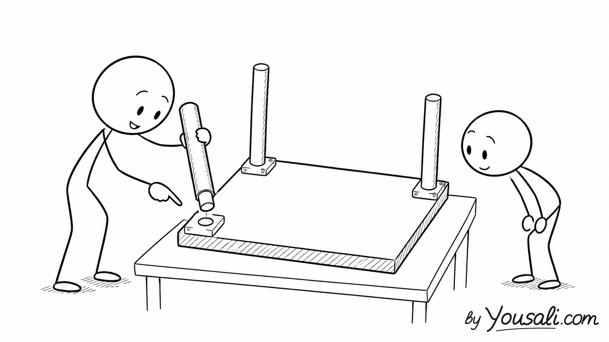

瑞典家具品牌宜家（IKEA）让顾客自己动手装桌子的做法，最初源于供应商 Ovendals 的一次接头示范。据[宜家博物馆的平板包装史](https://ikeamuseum.com/en/explore/the-story-of-ikea/flatpacks/)记录，这次早于 1953 年的连接件示范启发了创始人英格瓦·坎普拉德，让顾客在买回家后通过连接件自己装好桌子成了可行的办法。

这个想法很快落到了商品目录里。1953 年，宜家在目录中收录了 DELFI、KÖKSA 和 RIGA 这三张桌子。作为宜家较早一批可由顾客自己组装的桌款，这三款日常销售的桌子把连接件自装的做法真正跑了起来。

随着自装家具继续发展，拆装和压缩包装的实例也陆续记入宜家的历史。[宜家澳洲的品牌回顾](https://www.ikea.com/au/en/ideas/ikea-design-pubbd4e0881/)曾提到，员工伦德格伦（Lundgren）在 1955 年为了把桌子装进小车，动手卸掉了桌腿。到了 1956 年，可压成小包装的叶形桌 LÖVET 也登上宜家目录，据[宜家博物馆的目录史](https://ikeamuseum.com/en/explore/product-stories/lovet-coffee-table-1956/)介绍，这款桌子在 1962 年后从目录停列，直到 2013 年以 LÖVBACKEN 的名称重新回归。

从早期的可自装桌子到可压成小包装的叶形桌，把家具压成小包装并交由顾客自己动手组装的做法，方便了装运，也让宜家的配送变得更加高效。只是组装工序仍在，随着这套做法在后来不断扩张，包装里曾出现过缺螺丝和说明书难懂的问题，原本在工厂里完成的一部分装配，就这样转到了买回家后的顾客手上。
