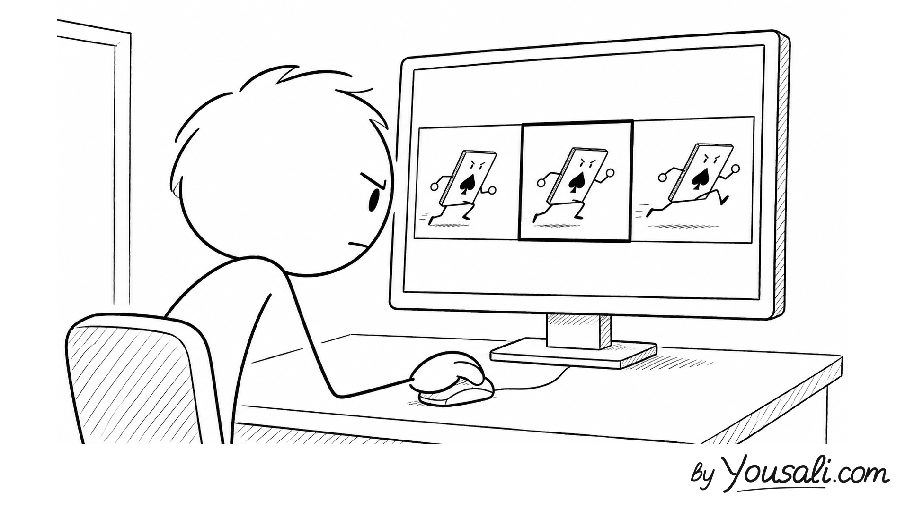

从广告公司辞职回家做动画时，杨宇没有固定收入，母子俩主要靠母亲每月[一千多元的退休金](https://www.cnbeta.com.tw/articles/tech/96554.htm)维持基本开销。后来他用“饺子”这个名字执导了《哪吒之魔童降世》，但在当时，他只是从四川大学华西药学院走出的年轻人，父亲也在他刚毕业时去世。大三时偶然接触到三维动画软件后，他便迷上了动画，起初在广告公司干了约一年，因觉得受商业项目限制，才决定自己动手做一部短片。

这一做，饺子后来在[央视访谈](https://news.cctv.com/2019/08/04/ARTI5uUMQbnifbNHcBjHJ47n190804.shtml)中回忆是三年零八个月，《电脑报》同期报道则记为三年半。那段时间里，他每天三点一线地生活。

短片的主要动画部分由他独自完成。杨宇在[央美专访](https://www.cafa.com.cn/cn/opinions/interviews/details/541054)中提到，片中纸牌冲锋的镜头要耗费过多内存，就算借来朋友的好电脑也依然内存溢出，他便开着软件手动渲染一帧又一帧，后期音乐则另外花五千元请人制作。就这样一点点磨，他做出了一部十六分钟的反战动画短片《打，打个大西瓜》，最初署名“饺克力”。到2009年，这部短片已经在网络上走红，后来[红星新闻实地采访](https://static.cdsb.com/micropub/Articles/201903/6013cc9b50c3757f232f68615600c2f3.html)时，记者在现场见到了三十多个奖杯奖状，其中就包括作品以 Jokelate 署名在[TBS官方档案](https://www.tbs.co.jp/digicon/history/12th.html)中记录的2010年第12届亚洲金奖。短片走红为他带来了组建工作室的机会，此后他一度靠接广告维持，直到几年后才迎来长片合作，制片人在采访中也提到当年短片的影响为后来的合作铺了路。

当年杨宇也曾担心坚持下来会没有收获，不过后来回看那段经历，他在[《新快报》同期报道](https://ent.sina.com.cn/x/2010-11-24/22203157422.shtml)中坦言，创作过程本身就已经有所收获。
