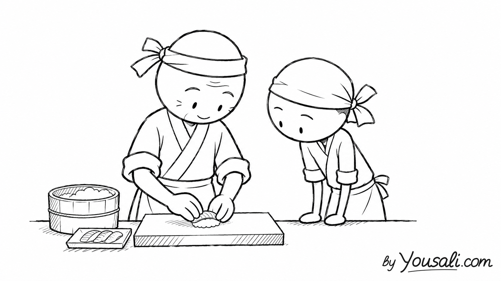

日本寿司师傅小野二郎曾先安排长子 Yoshikazu Ono 到东京赤坂的传统料理店接受训练，五年后才将他叫回。在此之前，小野二郎自己7岁便在旅馆工作，二战结束后继续在料理店学习，25岁成为寿司厨师，并于1965年在东京银座开店。

在[东京都采访的寿司师训练经历](https://www.tokyoupdates.metro.tokyo.lg.jp/en/post-1581/)中，长子 Yoshikazu 回忆起父亲对后辈的教法，提到父亲对自己和弟弟两兄弟更严格，并不会逐项解释做法，而是要求他们看着学。

当教导者不把做法逐项拆开说明，而是要求后辈自己看着学，学艺的重心便自然落在了观察上。对 Yoshikazu 和弟弟而言，父亲的严厉并不体现在细致的口头讲解里，而是落在看着学的要求中，手艺的门道并不靠听讲得来，而需要自己在旁留心去看。
