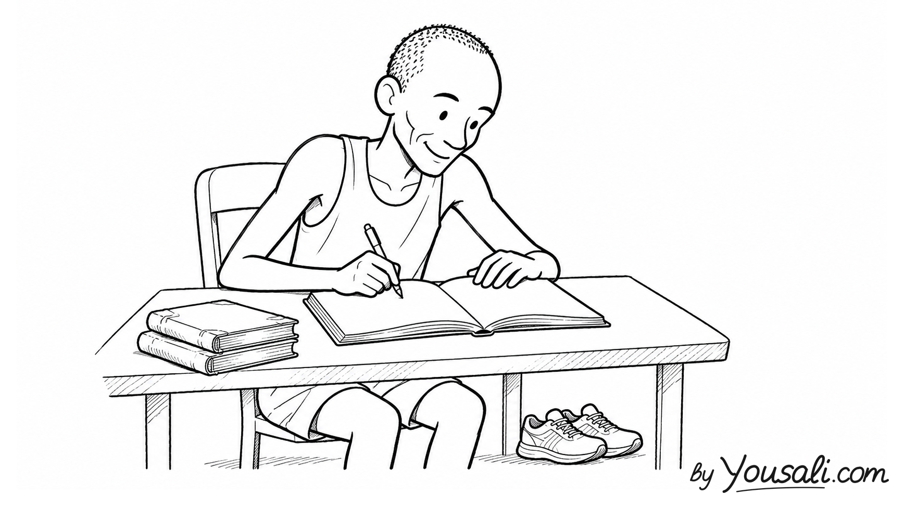

在卡普塔加特训练营，马拉松名将埃鲁德·基普乔格长期跟着教练帕特里克·桑训练。据[国际奥委会训练报道](https://www.olympics.com/ioc/news/eliud-kipchoge-marathon-revolutionary-training-methods)，这座训练营的训练结构整体以低强度跑为主，桑也会按交替长跑的方式来统筹安排训练节奏。

日常跑动之外，基普乔格一直保存着自己记录的训练本。2021 年他在[基普乔格本人访谈](https://www.sportsbusinessjournal.com/Daily/Issues/2021/08/23/Technology/marathoner-eliud-kipchoge-its-good-to-do-the-unthinkable/)中提到，自己已经保存了十八年的训练本，算下来大致从 2003 年前后开始，本子里会记下早上、中午和晚上的训练。日积月累下来，这沓跨度十多年的手记，实打实留存着他长期的训练轨迹。

在平常训练里，他反而会收着跑。基普乔格在[Outside现场采访](https://run.outsideonline.com/training/training-plans/marathon/eliud-kipchoge-marathon-workout-training-principles?scope=anon)中谈到自己的训练用力方式时表示，尽量不在训练里跑到百分之百，通常周二、周四和周六按八成力跑，其余日子按五成力跑。需要分清的是，这里的八成和五成是他本人对常规训练主观用力度的说法，并非最大强度指标，也不能和按训练量划分的八二比例混为一谈。放在训练营以低强度跑为主的整体结构里来看，日常大多保持在不跑满的节奏中，让训练得以日复一日延续下去。

长期维持这样的训练与记录习惯，基普乔格在大赛与专项挑战中都跑出过顶尖成绩。在[世界田联赛果](https://worldathletics.org/news/report/eliud-kipchoge-world-record-berlin-marathon-2022)记录的 2022 年柏林马拉松上，他以 2 小时 01 分 09 秒打破了当时由他在 2018 年柏林创下的 2 小时 01 分 39 秒世界纪录。2019 年在维也纳，据[INEOS 1:59主办方](https://www.ineos159challenge.com/news/eliud-kipchoge-achieves-his-moon-landing-moment)公布的结果，他在挑战中跑出 1 小时 59 分 40 秒。不过，维也纳那场 1 小时 59 分 40 秒并不是正式世界纪录，当时现场专门由配速团队轮换配合。对照这两次表现就能看清，运动员个体在平日里靠长年训练积累的能力，和特定赛事条件下借助团队配合跑出的成绩，所依赖的条件原本就不同。

比赛之外，训练营里的日子还是照旧，继续跟着教练完成早中晚的训练，再把当天的训练情况记进本子里。
