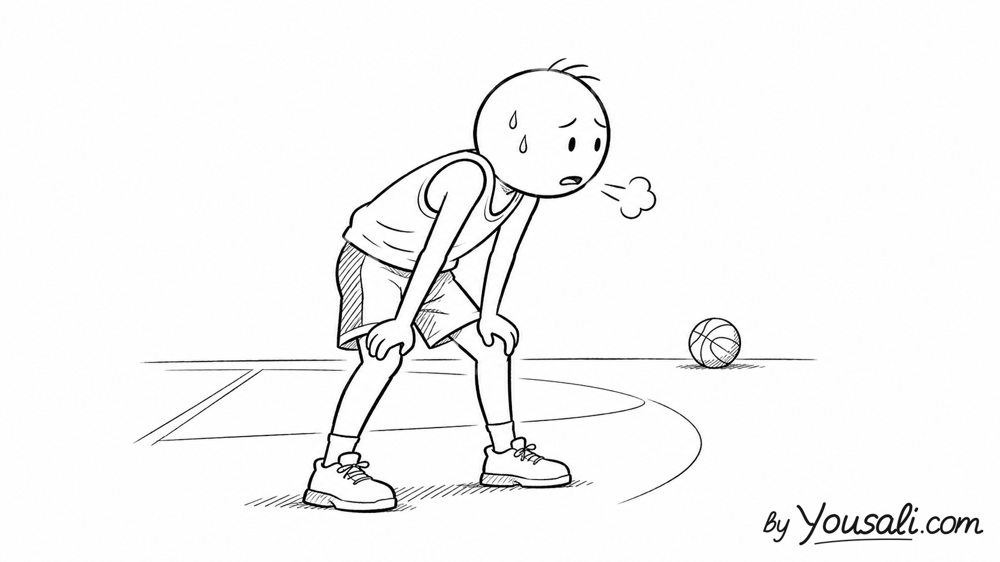

长期与科比·布莱恩特合作的知名训练师蒂姆·格罗弗，在个人著作《Winning》的[官方节选](https://www.simonandschuster.biz/books/Winning/Tim-S-Grover/Tim-Grover-Winning-Series/9781982168865)中回忆过一次训练调整。格罗弗写到，他曾提议科比在累的时候弯下腰喘气，科比起初认为这个动作不好看，拒绝了这个建议。

不过据格罗弗讲述，科比后来还是试了这一做法。在同一节选里，格罗弗也写到自己曾和科比在拉斯维加斯沙漠的正午骑行，两人的合作内容同样包含身体与恢复管理，这段经历在他的笔下也呼应了科比面对训练安排时愿意亲身去试的一面。

从因动作不好看而拒绝，到后来实际去试弯腰喘气，格罗弗在回忆中记下了科比对这项训练调整的采纳，并在自己的讲述里认为这一调整确实有用。
