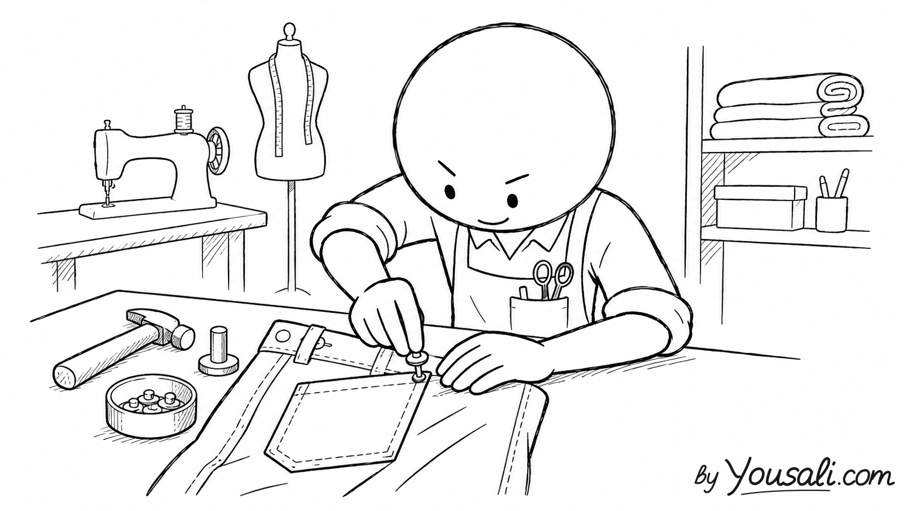

那条工装裤的出现，始于内华达州里诺的一笔寻常定制。当地一位女子找到裁缝雅各布·戴维斯，请他为丈夫做一条耐穿的工装裤。戴维斯原本从事马毯制作，习惯使用铆钉，于是把同样的铆钉用到了容易裂开的裤兜缝边上。这段源自女客户定制的改良经过，后来也由[李维斯企业档案馆基于专利诉讼文书的考证](https://www.levistrauss.com/2024/06/11/truth-and-exaggerations-of-lsco/)予以确认。

戴维斯并没有把这项做法只留在自己的裁缝铺里。他的布商李维·斯特劳斯于 1853 年抵达旧金山经营干货批发。1872 年，戴维斯写信给李维·斯特劳斯，邀请他共同申报专利。1873 年 5 月 20 日，第 139121 号专利获批。据[美国专利 US139121A 原始文书](https://patents.google.com/patent/US139121A/en)记载，戴维斯向自己及李维·斯特劳斯公司转让了专利权益，文书明确说明铆钉用于裤袋开口处，以防止缝线裂开。企业实物档案也显示，这类工装裤相继使用过棉帆布和丹宁布。

拿到专利授权并不代表产品就能顺利立足，产品的出现同样要靠专利执行。根据[美国国家档案馆专利诉讼个案](https://prologue.blogs.archives.gov/2010/05/20/forever-in-blue-jeansand-in-court/)记录，1874 年 1 月，距离专利获批不到一年，戴维斯和斯特劳斯就已经对侵权行为提起诉讼。从马毯工艺移用到工装裤上的铆钉，最终能够支撑起一款正式产品，靠的不只是裤兜缝边上的加固，也离不开获批之后通过诉讼守住的专利边界。
