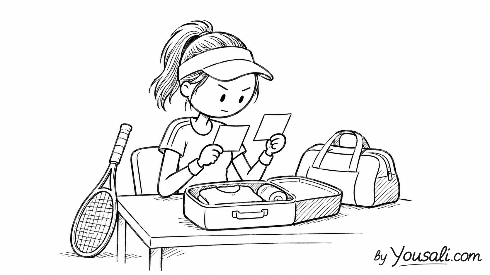

2008 年底，中国网球选手李娜离开国家队“单飞”。在此之前，她一直在国家队体系内接受培养，由国家队统筹训练和参赛，这段经历也为她提供了训练和竞赛基础。据[《时代》周刊](https://time.com/100575/the-meaning-of-li-na/)报道，在过去的旧制度下，选手曾需要将 65% 的收益上交。

离开国家队后，李娜得以自主决定赛程、聘请教练并自行承担相应开销，不过她仍需上缴部分收益。自主空间扩大后，原本由国家队统筹的团队事务也随之转到了个人肩上。

这些事务最先体现在具体的生活细节里。据[《时代》周刊](https://time.com/100575/the-meaning-of-li-na/)对李娜的第一人称采访报道，离开国家队后，她第一次自己预订并支付机票和旅馆，自己办理签证。为了寻找并面试合适的教练，她与丈夫姜山还一起自学英语，并共同承担起团队运转的日常工作。

随后的几年里，李娜在职业赛场先后取得两项重要突破。据 [WTA 对李娜职业生涯的回顾](https://www.wtatennis.com/news/3722827/wta-50-li-nas-legacy-beyond-the-white-lines-of-the-tennis-court)，她在 2011 年夺得个人首个大满贯单打冠军，成为亚洲首位大满贯单打冠军，到了 2014 年，她又赢下了澳大利亚网球公开赛。这两座大满贯是她此后在赛场上的成绩，而从第一次自己订机票和旅馆、办签证到学英语面试教练，这些亲手扛下的日常事务，正是她为这份自主付出的具体代价。
