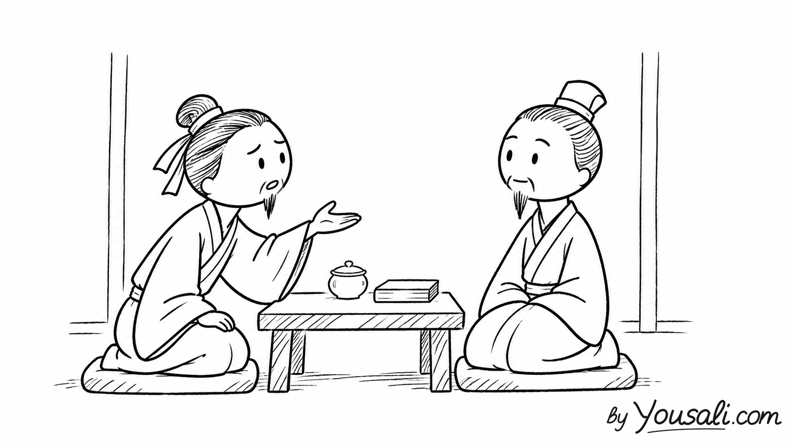

西晋陈寿所撰[《三国志·诸葛亮传》及裴松之注](https://zh.wikisource.org/wiki/%E4%B8%89%E5%9C%8B%E5%BF%97/%E5%8D%B735)中，保留了刘备三顾诸葛亮的记载。按《三国志·诸葛亮传》正文的叙述，刘备此前几番受挫、一直没能立足，经徐庶推荐并建议亲自拜访，他便亲自登门，去了三次才见到诸葛亮。裴松之作注时虽另录过先见的异说，但也引用诸葛亮的奏书支持三顾之说。

见到诸葛亮后，刘备先让随从退下，也就是史书所说的屏人。他直接把自己的处境和志向摆了出来，坦承自己能力短浅，一路几番受挫才落到今天，随后问道：“然志犹未已，君谓计将安出？”

这几句话不算长，却把平时最难开口的实情摆上了台面。话已经说得很低了，他偏又留了一句“志犹未已”，点明纵使处境窘迫，原有的目标依然没有放下。把短处与志向都交代明白，才开口请诸葛亮拿个主意。

面对这样的发问，诸葛亮按曹操、孙权以及荆州、益州的局势分别给出分析与回应。刘备听完，只应了一声“善”，两人此后日渐亲密。

话能问到这一步，其实并不多见。向人求计却先把短板亮出来，本身就带有实实在在的风险。刘备敢这样开口，是在三次登门见到人后，先借“屏人”让随从退下，划出私密而体面的谈话边界，做完这些，才把关乎真实处境与未竟之志的底牌放到桌上。
