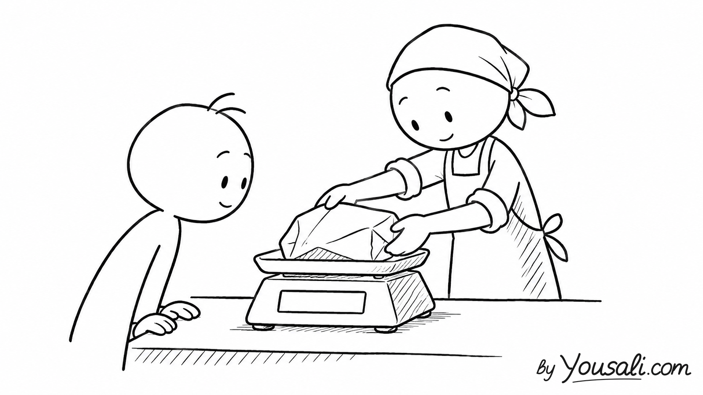

1999 年，陆步轩在西安长安车站旁支起了一家小肉店。刚开业时，他总躲在店后，把迎客卖肉的活交给专门请来的师傅。大约半年后，因为店里生意不好，他辞退了师傅，自己站到肉案前操刀。

站到肉案前以后，陆步轩开始改变店里的做法。他在[2003 年央视《面对面》访谈](https://www.cntv.cn/program/mdm/20030909/101496.shtml)中回忆，当时他把原来的弹簧秤换成按五克计量的电子秤，称重更为精细，换秤当天就赚了十元。他在同一场访谈中还说，自己进的是好货，卖价虽然比附近贵，却卖得更早。

后来肉店做出了不错的销量，不过不同年份的媒体报道采用了不同的计量口径。2003 年央视在报道中按斤数记录他的销量，而[《解放日报》2016 年现场访问陆步轩](https://www.jfdaily.com/wx/detail.do?id=31631)时，记者则记述他从小店做到自己用刀，在 2002 年前后达到过 12 至 15 头的较高销量。

在[2016 年《21世纪经济报道》的采访](https://m.21jingji.com/article/20160930/herald/0dd362454c4726f7608fb86a1c2f690f.html)中，陆步轩提到自己后来也会巡视档口，根据当地消费习惯做技术指导。谈及修志与卖肉，他则说，修志要秉笔直书，卖肉要足斤足两。
