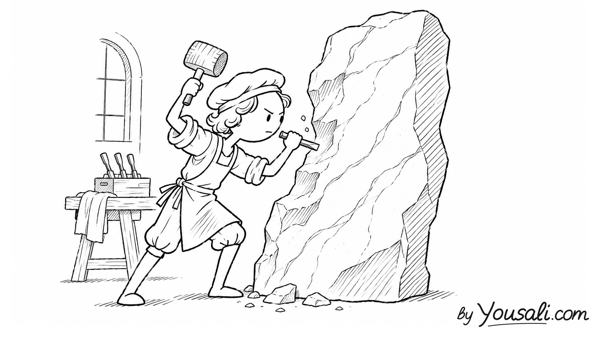

1501 年 7 月，佛罗伦萨圣母百花大教堂工程处委员决定试着把院中一块粗凿过、横躺着的大理石立起来。据[《Michelangelo’s David》对工程处委托档案的整理](https://api.pageplace.de/preview/DT0400.9781316236352_A23714070/preview-9781316236352_A23714070.pdf)，当时工程处提出将这块大卫石料立起，就是为了判断它还能不能继续雕刻。

这块石头此前已经有人动过工。学者保罗·乔阿尼德斯在[《Matters of State》一文](https://www.academia.edu/90236670/Matters_of_State_Michelangelo_s_David_)中援引委托档案指出，早先雕塑家安东尼奥·罗塞利诺曾对这块石料做过加工。1501 年工程处决定重新评估续做的可行性，大约六周之后，才正式把这项委托交给了当时 26 岁的米开朗基罗。

米开朗基罗接手后，从这块既有石料中雕出了《大卫》。雕像呈现出鲜明的人体造型，大卫取一个紧收的站姿，重心落在单腿上，稳稳立住的同时做出了一身张力。

雕像完成后的安放位置，也与最初的委托规划形成了反差。据[佛罗伦萨主教座堂工程处的艺术遗产介绍](https://duomo.firenze.it/en/151/arte/scroll)，1501 年的委托原本计划将它作为教堂穹顶扶壁雕像，但作品最后并没有放到教堂高处，而是摆到了佛罗伦萨市政宫外。
