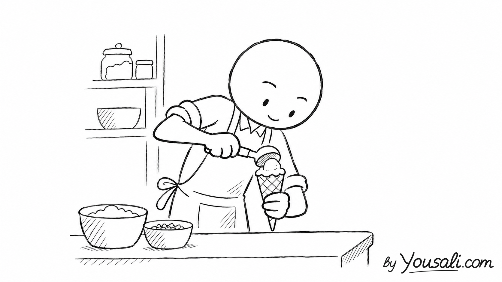

1997年，蜜雪冰城创始人张红超在郑州开起“寒流刨冰”小店，当时使用的是一台自制刨冰机。1999年，“蜜雪冰城”品牌正式启用。据[港交所招股书业务章节第183页](https://www1.hkexnews.hk/listedco/listconews/sehk/2025/0221/2025022100010_c.pdf)披露，在品牌启用之后，张红超仍在持续探索产品方向。

2005年，他在持续探索中研制出一元蛋筒。按照招股书披露的企业记录，这款产品以牛奶、鸡蛋、玉米粉和白糖为原料，经过反复试配后以一元的价格出售，最终取得了市场反响。

从一台自制刨冰机开店起步，到把寻常食材试配成一元蛋筒，张红超早年的尝试并没有等待昂贵的设备或稀缺的原料。依托手头可及的基础条件反复调整，把价格落在大众容易接受的一元位置，正是这间小店在多年探索中拿到真实市场回响的方式。
