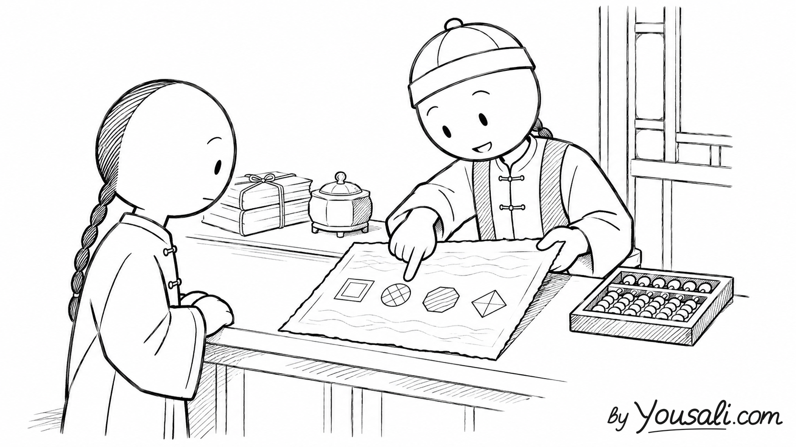

[平遥县票号博物馆](https://wulanchabuxinwenwang.platform.xinhuaapp.com/detail/d9de02eea1204548bdc9c04eeefeb546?contentType=1&t=MjAyNi0xMS0yMA%3D%3D)藏有一张道光二十六年的汴城会券，票面写着500两，约定在京都本号见票交付，上面钤有四种印章，并批有“无用”字样，表明这笔款项已经结算。

在日昇昌办起之前，清代各地商旅往来渐密，可商人们最发愁的还是长途运送现银。那时各处银两的成色和重量并不统一，异地结账往往只能装起沉甸甸的银子，雇镖局一路护送，一趟走下来开销大，途中又常遇盗匪。山西平遥西大街有家西裕成颜料庄，北京分号经理雷履泰常年在异地赊销与账目往来里打交道，看出其中的汇兑门道，便劝东家李大全把颜料庄改组为专营异地汇兑的票号。在李大全的支持下，日昇昌票号由此成立，由雷履泰出任首任总大掌柜。

日昇昌的汇票让商人省去了押运现银的麻烦，只需凭一张纸就能异地取款。汇票轻巧，最怕假票冒领。从博物馆的展陈来看，票号的防伪核验并非一步到位，而是随着时间逐步叠加。早期兑付之前，分号之间主要核对笔迹、纸张和印章，道光二十六年的汴城会券上留有四种印章，正是当时的做法。按馆方讲解员介绍，后来用于防伪的汉字密押，其实直到同治年间才引入日昇昌。

在号内人事上，日昇昌由东家持有所有权，掌柜掌管经营，并按年终考核的结果加股发薪。管事的人吃的是长远饭，日常行事也就格外看重字号的长期信用。

不过，笔迹、纸印加上同治年间的汉字密押，并没有让异地兑付变成只认一张纸的事。到了后来，只要遇上大额兑付，日昇昌仍然须要查验取款人，并额外找人担保。纸面上的核验一层层加细，可真到金额大了以后，依然绕不开验人与担保。
