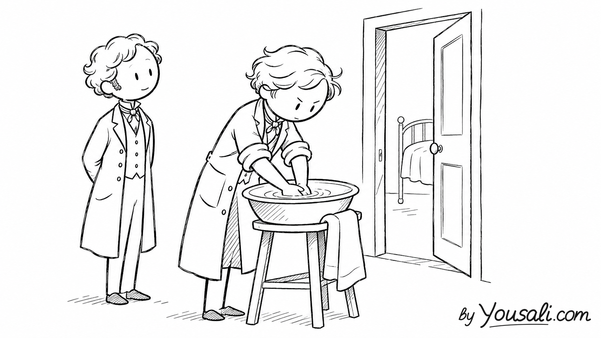

1840 年代，奥地利维也纳总医院有两个产科病房，产妇按日轮流接诊，匈牙利裔产科医生伊格纳兹·塞麦尔维斯就在第一病房工作。同在一家医院里，两边的死亡率却差得很远。第一病房由医生和医学生负责，第二病房由助产士学员负责。两个病房的训练差别明显：医生和医学生日常需要参与尸体解剖，之后直接进入产房接触产妇，第二病房的助产士学员却不进解剖室。根据[塞麦尔维斯 1861 年原著](https://academia.dk/MedHist/Biblioteket/Print/semmelweis_1861.html)报告，1846 年第一病房的产褥热死亡率达 11.4%。一项发表在[《European Journal of Epidemiology》的历史数据重分析](https://pmc.ncbi.nlm.nih.gov/articles/PMC9209376/)根据原始月数据指出，1847 年 4 月第一病房的死亡率更是达到 18.3%，远高于第二病房。

那会儿医学界流行用瘴气或体质差异来解释这种现象，可这些说法圆不上两个病房的悬殊。不过，两边的差异也不能简单当作唯一的变量。上述[历史数据重分析](https://pmc.ncbi.nlm.nih.gov/articles/PMC9209376/)就指出，按日轮流接诊不能当作随机对照，早前院内更换助手时死亡率也曾下降，而转病房等安排同样会改变原统计中的死亡数字。

真正改变塞麦尔维斯假说的，是法医学者科莱奇卡的死。按照[1861 年原著](https://academia.dk/MedHist/Biblioteket/Print/semmelweis_1861.html)的记述，科莱奇卡被解剖刀刺伤后去世，塞麦尔维斯从他的病变中看到，其表现与死于产褥热的产妇相似。他据此怀疑是手把致命物质带进了产房：既然解剖刀刺伤能把尸体上的物质带入体内并引发相似病变，那么刚参与完解剖的医生和医学生直接去接触产妇，双手也可能成为传播媒介。

1847 年 5 月中旬，塞麦尔维斯要求第一病房的医生和医学生在接触产妇前先用含氯溶液洗手，后来改用氯化石灰。他将这种经手带入的致病物质解释为尸体微粒，这一说法在同行之间引发了不少争论。不过，洗手前后的数字变化摆在眼前：第一病房的死亡率曾是 1846 年的 11.4%，并在 1847 年 4 月升至 18.3%。到了实行洗手的 1848 年全年，第一病房的死亡率降至 1.27%，与同年第二病房的 1.33% 已经相近。

