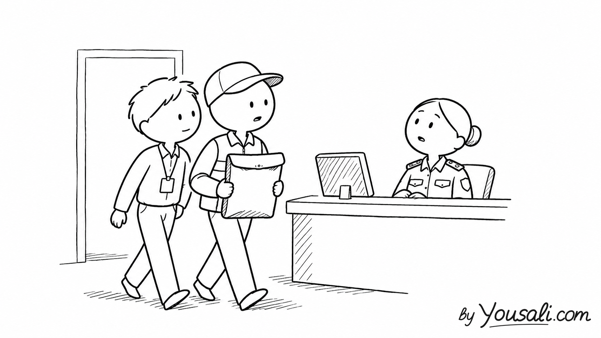

2016 年 4 月 17 日，北京富贵园，一名顺丰快递员派件时，和一辆小轿车发生了剐蹭。轿车司机随后辱骂并掌掴了这名快递员，现场视频及警方均证实了这一冲突。这段视频很快在网上流传开来。

事发当时，快递员并没有立刻报警。据[央广网报道](https://country.cnr.cn/focus/20160420/t20160420_521928834.shtml)，当事快递员表示，他当时怕耽误后续派送，宁愿先把事情了结。现场目击者称，快递员先给了对方 400 元，随后才由公司人员陪同报警。

4 月 18 日，顺丰方面明确拒绝对方调解。据[澎湃新闻报道](https://m.thepaper.cn/newsDetail_forward_1457949)，顺丰总裁王卫当天在与媒体交流时，承认了自己此前在微信朋友圈的表态，并说明拒绝调解是公司的明确选择，他在会上问起今后怎样面对员工。

同一天，东城警方通过平安东城发布通报，依法对涉事司机处以行政拘留十日。这一治安处罚由警方依法独立作出，并非企业拒绝调解促成的决定。

在这件事里，当事快递员起初想靠赔钱息事宁人，顾虑的是不耽误手头的派件。公司人员随后陪同报警，顺丰次日又明确拒绝调解，让事情没有停在个人退让这一步。最终，打人者的代价由警方依法独立裁定，企业则在员工遇事时接过支持，把今后怎样面对员工摆在了前面。
