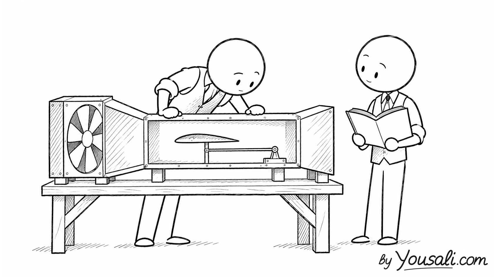

1901 年，威尔伯·莱特和奥维尔·莱特试飞了一架滑翔机。兄弟俩起初按李林塔尔的升力表与当时通行的计算方式估算表现，可滑翔机离地试飞后，实测得到的升力却只有预期的约三分之一。根据[NASA 格伦研究中心对 1901 年测试记录的解读](https://www.grc.nasa.gov/www/k-12/airplane/wrights/test1901.html)，面对这一落差，他们先是从当时的风筝与滑翔实测数据中推算出约 0.0033 的系数，并没有在事后才去修正这组数字。

不过，只把系数调到 0.0033 仍然解释不完升力偏差。[美国国会图书馆馆藏的 1901 至 1902 年原始信札与记录](https://www.loc.gov/exhibits/dreamofflight/dream-achieve.html#obj064)显示，威尔伯在 1901 年 10 月写下的信里，就已经直接对李林塔尔的升力表提出了质疑。为了进一步核对升力规律，兄弟俩先是用自行车另做了一轮模型比较，随后又转入可控气流环境，在风洞里开发了两套天平来测试模型。

这轮风洞实测很快就测出了旧表的问题所在。在[NASA 所收威尔伯 1901 年 12 月 15 日致 Sprat 与 Chanute 的信件原文](https://www.nasa.gov/wp-content/uploads/2023/03/sp-4409-vol1.pdf)中，威尔伯写信告诉 Sprat，他们已经测过约 30 个表面在多个迎角下的升力，并在信里把同一个翼形在不同迎角下的实测结果与李林塔尔的数据并列比较，指出了两者之间的具体差异。

到了 1902 年 1 月，莱特兄弟整理出了风洞测值表，同一年他们也继续进行了滑翔试飞，这份 1902 年 1 月的测值表与当年的滑翔照片如今都保存于美国国会图书馆的馆藏之中。从实飞发现升力只有预期的约三分之一，到在可控气流里逐个重测翼形与迎角，那张沿用已久的旧升力表，最终被兄弟俩自己测出的数据替了下来。
