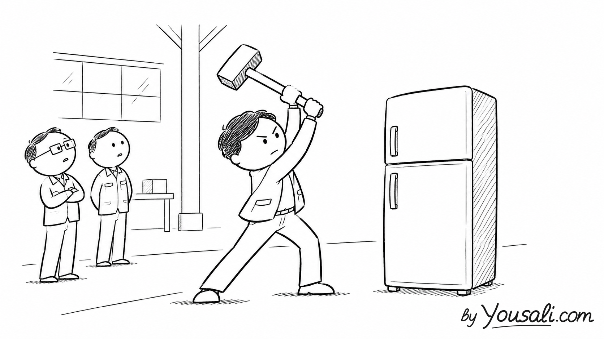

1985年，青岛电冰箱总厂（也就是海尔的前身）发现了76台问题冰箱。据厂长[张瑞敏在2018年的第一人称回忆](https://news.enorth.com.cn/system/2018/12/22/036562143.shtml)，早在砸冰箱之前，厂里就已经先从利勃海尔引进了全套设备与技术。面对查出的这批问题冰箱，厂里有人建议低价卖给员工。

张瑞敏没有同意。他否决了低价卖给员工的提议，并召开现场会处理这批产品。根据张瑞敏的回忆以及[海尔品牌档案的企业记录](https://www.haier.com/group/about-haier/jtzl/ppzljd/)，他在现场会上自己带头举起大锤，当众砸毁了这批次品。

至于当时为何不肯低价处理这批冰箱，张瑞敏在2018年回忆此事时以760台作了事后解释，表示允许卖掉眼前的76台问题冰箱，就意味着后续可能再出现760台同类产品。他借这个对照，说明了当年拒绝内部低价消化的考虑。

不过，这次公开毁损次品并非全部过程。张瑞敏在同一次自述中提到，厂里引进利勃海尔全套设备与技术后，也将对方的1942条标准逐条进行了转化。在海尔品牌档案的记录里，1988年，青岛电冰箱总厂的产品获得了国家优质产品实物金牌。

后来，据[海尔集团的回顾记载](https://www.haier.com/press-events/news/20211108_172896.shtml)，这把砸冰箱的大锤被中国国家博物馆永久收藏，相关记载中还列出了当时的馆藏编号。回看这段经过，1985年现场砸毁76台次品的那一锤，与围绕1942条标准推进的日常转化工作，一同留在企业关于质量管理的记录里。
