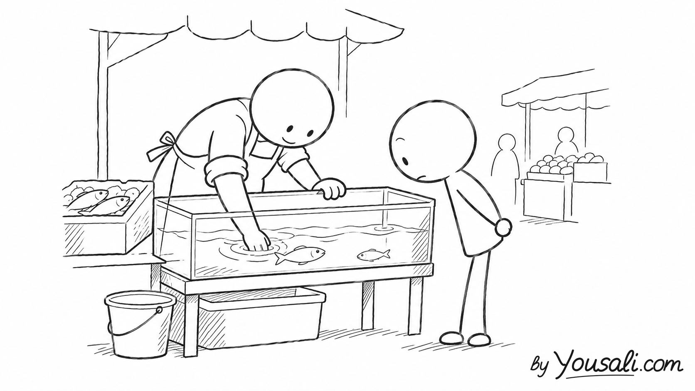

演员张颂文平时常逛菜市场。2020年澎湃新闻的[人物现场采访](https://www.thepaper.cn/newsDetail_forward_8133747)记录过他在市场里的现场状态：他和摊主以及周围的街坊都很熟络，遇上摊主忙不过来时，还会从容坐下来帮熟识的摊主卖菜，同时留意来往的人。

后来他出演电视剧《狂飙》里的高启强，片子里有一个在鱼缸里洗手的动作。[张颂文谈及这个角色动作](https://www.thepaper.cn/newsDetail_forward_21725846)时明确说过，这一处是他自己设计的，出自在菜市场见到鱼档老板这样做。

对张颂文来说，去菜市场不只是买东西，而是和摊主、街坊熟络往来，并在一旁留心看着身边来往的人。那些在生活现场见过、留意过的真实举动，后来便自然地落到了戏里。
