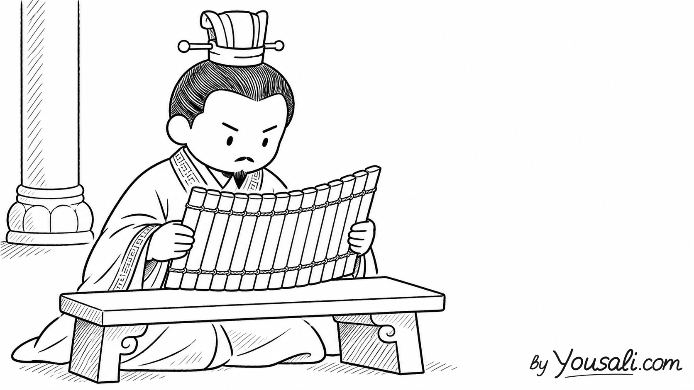

秦赵长平之战期间，秦军几次击败赵军，赵国老将廉颇于是筑壁不出，选择固守。据[《史记》卷73](https://zh.wikisource.org/wiki/%E5%8F%B2%E8%A8%98/%E5%8D%B7073)记载，赵王不满廉颇屡战失利又固守不出，多次责备于他。秦国趁机施展反间计，在赵国散布关于赵括的传话，赵王听信了这些流言，执意要把廉颇换下来，改由赵括统兵。

对于让赵括接掌兵权一事，熟悉他的人与朝中大臣早有异议。据[《史记》卷81](https://zh.wikisource.org/wiki/%E5%8F%B2%E8%A8%98/%E5%8D%B7081)记载，赵括的父亲赵奢先前就曾对儿子有过评价，换将的消息传开后，赵国大臣蔺相如也对赵括给出评价并出面反对。之后，连赵括的母亲也上书劝阻赵王。她在信中指出，赵括平时对待军吏的态度，以及对待君王赏赐的态度，都与父亲赵奢不同，以此劝阻任命儿子为主帅。可赵王回应说自己已经决定了，没有听从母亲的劝阻。

赵括抵达长平前线后，随即更改了原有的军令约束，并调换了军吏。然而，秦军在交战中击败了赵军，并切断了赵军的粮道。到了九月，前线赵军断食已有四十六日。最终，赵括战死，赵军大败，大批投降的赵军也被秦军杀害。

回顾这场长平易将，赵王真正面对的是连败不止与固守难进的僵局，想靠换帅打破困境本在情理之中。可他在听信秦国反间传话后便执意拍板，面对赵括母亲指出的对待军吏与受赐态度与父辈不同的具体提醒，仍以已经决定为由拒绝回转。等到新帅在阵前改令换将，留给赵军的却是粮道断绝与断食四十六日的败局。
