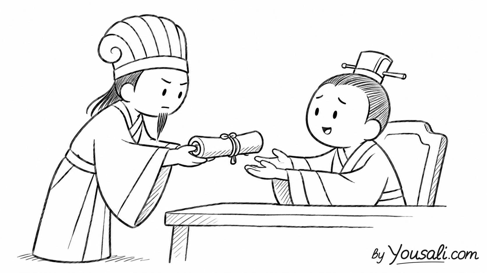

建兴五年，蜀汉丞相诸葛亮动身前往汉中前，向后主刘禅递上一份[《出师表》](https://zh.wikisource.org/wiki/%E4%B8%89%E5%9C%8B%E5%BF%97/%E5%8D%B735)。真要把它摊在案头，当作一位重臣临行前的书面交代来读，字里行间其实是在把几件要紧事一项项写清：人主遇到不同事务该向谁咨询，宫中与府中用什么尺度赏罚，以及前方与后方各自如何问责。

诸葛亮在表里先为刘禅分清了不同事务的咨询对象。遇到宫中事务，表文写明刘禅应当询问郭攸之、费祎和董允。遇到营中事务，则写明应当询问向宠。表里点名这几位臣子，是要把他们作为人主遇事问计的对象，各自对应宫务与营务，并不是把权力全盘交给他们。这样划开之后，刘禅遇事便知道该找谁商议。

咨询对象定了，办事的规矩也得一并说清。诸葛亮在表文里把赏罚的尺度合到一处：不管在宫中还是府中，赏罚评判都应当采用同一套标准，不留内外两套标准的口子。连怎么问责，他也提前划在了明处。表里写明，前线出师若无成效便治诸葛亮自己的罪，未能尽责进谏则追究郭攸之、费祎、董允等人的责任。他把自己在外的军务责任和留守诸臣进谏的职责一件件摆开，把宫府一致的规矩和各自的问责边界交代清楚。

至于丞相府留在后方的实际政务，并不是由这份奏表直接交代，而是见于另一篇传记。据陈寿[《三国志·蒋琬传》](https://www.shidianguji.com/book/LS0004/chapter/1j7fnuwp8dmpp_262)所记，建兴五年诸葛亮住汉中时，留府事务由蒋琬与长史张裔主持。诸葛亮在外期间所需的粮食和兵员，后来也常由蒋琬补足。前线战事成败由诸葛亮自己承担，宫中与营中的咨询和进谏之责在《出师表》里写明，留府事务由蒋琬、张裔在后方经手，在外所需的粮食与兵员则常由蒋琬补给，前线打仗的成败与后方支撑的担当，就这样各自落在了具体的人身上。
